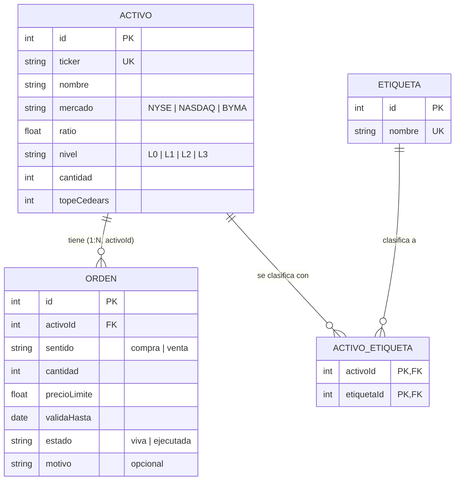

# API Activos y Órdenes

Trabajo Práctico Integrador de **Taller de Programación 2** (ORT Argentina, curso de los miércoles). API REST en Node + Express con arquitectura en capas, persistencia intercambiable (memoria o SQLite con Sequelize), validación con Zod, errores centralizados, eventos de dominio y documentación OpenAPI con Swagger UI.

Entrega individual de Tomás José Martínez (grupo 4).

## Dominio

Un recorte **hipotético** de un sistema personal de inversiones en CEDEARs (certificados que representan acciones del exterior y cotizan en Argentina). La idea central: **el sistema no coloca órdenes en el broker**. Arma la orden, verifica que respete las reglas de la cartera y avisa con una «tabla para colocar a mano». Todos los datos son inventados.

### Entidades

**Activo** (`/activos`): un CEDEAR que el sistema sigue.

| Campo | Tipo | Reglas |
|---|---|---|
| `id` | entero | autoincremental |
| `ticker` | texto | único; `^[A-Z][A-Z0-9.]{0,9}$` (se pasa a mayúsculas) |
| `nombre` | texto | no vacío |
| `mercado` | texto | `NYSE` · `NASDAQ` · `BYMA` |
| `ratio` | número | > 0: cuántos CEDEARs equivalen a una acción |
| `nivel` | texto | `L0` · `L1` (solo seguimiento) · `L2` (lista para comprar) · `L3` (con posición) |
| `cantidad` | entero | ≥ 0: CEDEARs en cartera (por defecto 0) |
| `topeCedears` | entero | > 0: máximo de CEDEARs permitido para este activo |
| `etiquetas` | lista | `[{ id, nombre }]`, solo en las respuestas (relación N:N) |

**Orden** (`/ordenes`): una intención de compra o venta sobre un activo.

| Campo | Tipo | Reglas |
|---|---|---|
| `id` | entero | autoincremental |
| `activoId` | entero | el activo de la orden (clave foránea) |
| `sentido` | texto | `compra` · `venta` |
| `cantidad` | entero | > 0 |
| `precioLimite` | número | > 0, en US$ por CEDEAR |
| `validaHasta` | fecha | `AAAA-MM-DD` |
| `estado` | texto | `viva` · `ejecutada`; no se envía: toda orden nace `viva` |
| `motivo` | texto | opcional, hasta 400 caracteres |
| `activo` | objeto | `{ id, ticker }`, solo en las respuestas (relación 1:N) |

**Etiqueta** (`/etiquetas`): un rótulo para agrupar activos (`dividendos`, `tecnologia`, `defensivo`).

| Campo | Tipo | Reglas |
|---|---|---|
| `id` | entero | autoincremental |
| `nombre` | texto | único; `^[a-z][a-z0-9-]{1,29}$` (se pasa a minúsculas) |

Al arrancar, la API carga una semilla de ejemplo: 3 activos (KO, AAPL, GGAL), 3 órdenes (una ya ejecutada), 5 etiquetas y 4 vínculos activo–etiqueta.

### Relaciones

- **Activo 1 : N Orden.** Cada orden pertenece a un activo (`activoId`); un activo tiene cero o más órdenes. Cada orden se devuelve con su activo anidado (`activo: { id, ticker }`), y las órdenes de un activo se piden en `GET /activos/{id}/ordenes`.
- **Activo N : N Etiqueta**, a través de la tabla intermedia `activo_etiquetas` (clave primaria compuesta `activoId` + `etiquetaId`). Cada vínculo es un subrecurso: `GET`, `POST` y `DELETE /activos/{id}/etiquetas/{etiquetaId}`. Todo activo trae sus etiquetas anidadas, y `GET /activos?etiqueta=dividendos` filtra por una.

### Reglas de negocio

Viven en los casos de uso (`usecases/`) y responden con un código propio en el formato de error `{ "error": { "code", "message", "details?" } }`.

| # | Regla | Código | HTTP |
|---|---|---|---|
| 1 | El activo de la orden tiene que existir | `ACTIVO_NO_ENCONTRADO` | 404 |
| 2 | El ticker es único (también al editar) | `TICKER_DUPLICADO` | 409 |
| 3 | No puede haber dos órdenes vivas con el mismo activo, sentido y precio | `ORDEN_DUPLICADA` | 409 |
| 4 | Solo se compra en activos de nivel `L2` o `L3` | `NIVEL_NO_OPERABLE` | 409 |
| 5 | Lo que se vende no supera lo que hay en cartera menos las otras ventas vivas | `CANTIDAD_INSUFICIENTE` | 409 |
| 6 | Cartera + compras vivas + la compra nueva no superan el `topeCedears` | `TOPE_EXCEDIDO` | 409 |
| 7 | Una orden ejecutada no se modifica, no se borra ni se vuelve a ejecutar | `ORDEN_NO_MODIFICABLE` | 409 |
| 8 | No se borra un activo con órdenes (vivas o ejecutadas: el historial no queda huérfano) | `ACTIVO_CON_ORDENES` | 409 |

Las reglas 5 y 6 también se verifican al editar la `cantidad` o el `topeCedears` de un activo. La relación N:N suma las suyas: nombre de etiqueta único (`ETIQUETA_DUPLICADA` 409), la etiqueta tiene que existir (`ETIQUETA_NO_ENCONTRADA` 404), no se asigna dos veces (`ETIQUETA_YA_ASIGNADA` 409) y solo se quita una que el activo tiene (`ETIQUETA_NO_ASIGNADA` 404). Borrar una etiqueta en uso la saca de todos los activos.
