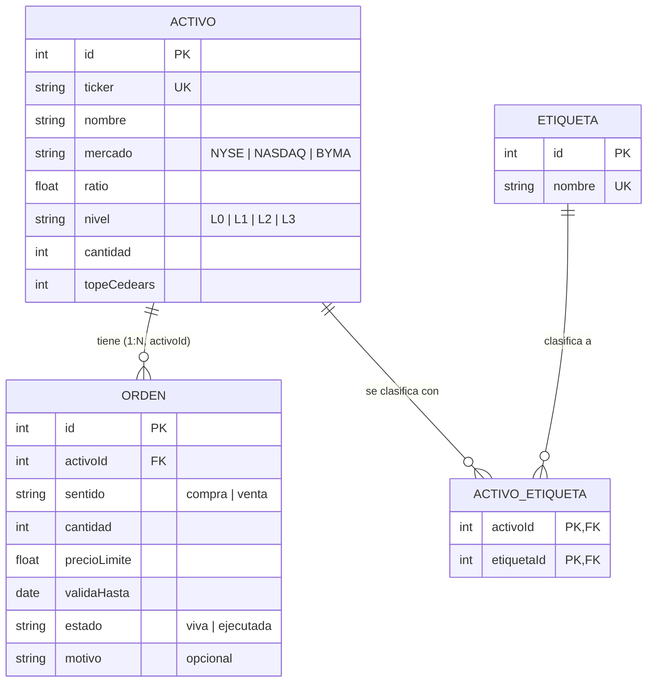

# API Activos y Órdenes

Trabajo Práctico Integrador de **Taller de Programación 2** (ORT Argentina, curso de los miércoles). API REST en Node + Express con arquitectura en capas, persistencia intercambiable (memoria o SQLite con Sequelize), validación con Zod, errores centralizados, eventos de dominio y documentación OpenAPI con Swagger UI.

Entrega individual de Tomás José Martínez (grupo 4).

## Dominio

Un recorte **hipotético** de un sistema personal de inversiones en CEDEARs (certificados que representan acciones del exterior y cotizan en Argentina). La idea central: **el sistema no coloca órdenes en el broker**. Arma la orden, verifica que respete las reglas de la cartera y avisa con una «tabla para colocar a mano». Todos los datos son inventados.

### Entidades

**Activo** (`/activos`): un CEDEAR que el sistema sigue.

| Campo | Tipo | Reglas |
|---|---|---|
| `id` | entero | autoincremental |
| `ticker` | texto | único; `^[A-Z][A-Z0-9.]{0,9}$` (se pasa a mayúsculas) |
| `nombre` | texto | no vacío |
| `mercado` | texto | `NYSE` · `NASDAQ` · `BYMA` |
| `ratio` | número | > 0: cuántos CEDEARs equivalen a una acción |
| `nivel` | texto | `L0` · `L1` (solo seguimiento) · `L2` (lista para comprar) · `L3` (con posición) |
| `cantidad` | entero | ≥ 0: CEDEARs en cartera (por defecto 0) |
| `topeCedears` | entero | > 0: máximo de CEDEARs permitido para este activo |
| `etiquetas` | lista | `[{ id, nombre }]`, solo en las respuestas (relación N:N) |

**Orden** (`/ordenes`): una intención de compra o venta sobre un activo.

| Campo | Tipo | Reglas |
|---|---|---|
| `id` | entero | autoincremental |
| `activoId` | entero | el activo de la orden (clave foránea) |
| `sentido` | texto | `compra` · `venta` |
| `cantidad` | entero | > 0 |
| `precioLimite` | número | > 0, en US$ por CEDEAR |
| `validaHasta` | fecha | `AAAA-MM-DD` |
| `estado` | texto | `viva` · `ejecutada`; no se envía: toda orden nace `viva` |
| `motivo` | texto | opcional, hasta 400 caracteres |
| `activo` | objeto | `{ id, ticker }`, solo en las respuestas (relación 1:N) |

**Etiqueta** (`/etiquetas`): un rótulo para agrupar activos (`dividendos`, `tecnologia`, `defensivo`).

| Campo | Tipo | Reglas |
|---|---|---|
| `id` | entero | autoincremental |
| `nombre` | texto | único; `^[a-z][a-z0-9-]{1,29}$` (se pasa a minúsculas) |

Al arrancar, la API carga una semilla de ejemplo: 3 activos (KO, AAPL, GGAL), 3 órdenes (una ya ejecutada), 5 etiquetas y 4 vínculos activo–etiqueta.

### Relaciones

- **Activo 1 : N Orden.** Cada orden pertenece a un activo (`activoId`); un activo tiene cero o más órdenes. Cada orden se devuelve con su activo anidado (`activo: { id, ticker }`), y las órdenes de un activo se piden en `GET /activos/{id}/ordenes`.
- **Activo N : N Etiqueta**, a través de la tabla intermedia `activo_etiquetas` (clave primaria compuesta `activoId` + `etiquetaId`). Cada vínculo es un subrecurso: `GET`, `POST` y `DELETE /activos/{id}/etiquetas/{etiquetaId}`. Todo activo trae sus etiquetas anidadas, y `GET /activos?etiqueta=dividendos` filtra por una.



### Reglas de negocio

Viven en los casos de uso (`usecases/`) y responden con un código propio en el formato de error `{ "error": { "code", "message", "details?" } }`.

| # | Regla | Código | HTTP |
|---|---|---|---|
| 1 | El activo de la orden tiene que existir | `ACTIVO_NO_ENCONTRADO` | 404 |
| 2 | El ticker es único (también al editar) | `TICKER_DUPLICADO` | 409 |
| 3 | No puede haber dos órdenes vivas con el mismo activo, sentido y precio | `ORDEN_DUPLICADA` | 409 |
| 4 | Solo se compra en activos de nivel `L2` o `L3` | `NIVEL_NO_OPERABLE` | 409 |
| 5 | Lo que se vende no supera lo que hay en cartera menos las otras ventas vivas | `CANTIDAD_INSUFICIENTE` | 409 |
| 6 | Cartera + compras vivas + la compra nueva no superan el `topeCedears` | `TOPE_EXCEDIDO` | 409 |
| 7 | Una orden ejecutada no se modifica, no se borra ni se vuelve a ejecutar | `ORDEN_NO_MODIFICABLE` | 409 |
| 8 | No se borra un activo con órdenes (vivas o ejecutadas: el historial no queda huérfano) | `ACTIVO_CON_ORDENES` | 409 |
| 9 | La validez de una orden (`validaHasta`) no puede ser anterior a hoy, al crearla o al cambiarle la fecha | `VALIDEZ_VENCIDA` | 409 |

Las reglas 4, 5 y 6 también se verifican desde el activo: al editar su `cantidad` o su `topeCedears` (5 y 6), al crearlo (6: no nace con más cartera que tope) y al cambiarle el `nivel` (4: con compras vivas no puede salir de `L2`/`L3`). La relación N:N suma las suyas: nombre de etiqueta único (`ETIQUETA_DUPLICADA` 409), la etiqueta tiene que existir (`ETIQUETA_NO_ENCONTRADA` 404), no se asigna dos veces (`ETIQUETA_YA_ASIGNADA` 409) y solo se quita una que el activo tiene (`ETIQUETA_NO_ASIGNADA` 404). Borrar una etiqueta en uso la saca de todos los activos.

## Instalación y ejecución

**Requisitos:** Node.js 20.17 o posterior (por `node --env-file` y `sqlite3` 6) y npm.

```bash
git clone https://github.com/AmEndeDerTage/tp2-grupo4.git
cd tp2-grupo4
npm install
cp .env.example .env          # en PowerShell: Copy-Item .env.example .env
npm start                     # o npm run dev, que reinicia solo al guardar un archivo
```

La API queda en `http://localhost:8000`, y por defecto escucha solo en esta máquina (`HOST=127.0.0.1`). Al arrancar, la consola informa qué persistencia y qué notificadores están activos.

Leer es público. **Para escribir hay que iniciar sesión**: con el `.env` de ejemplo, usuario `operador` y contraseña `mellon-1234` (ver [Seguridad](#seguridad)).

> **npm 12:** no corre los scripts de instalación de las dependencias salvo que estén autorizados. `sqlite3` necesita el suyo para bajar su binario, así que `package.json` lo autoriza en `allowScripts` (y deja afuera la telemetría de `@scarf/scarf`). Con `npm install` alcanza; si se actualiza `sqlite3` de versión hay que volver a autorizarlo: `npm install-scripts approve sqlite3`.

### Variables de entorno

Se leen del archivo `.env` (con `node --env-file=.env`, sin `dotenv`). `config/config.js` es el único módulo que las lee, y corta el arranque con un mensaje claro si una tiene un valor inválido.

| Variable | Valores | Por defecto | Para qué |
|---|---|---|---|
| `PORT` | número | `8000` | Puerto del servidor |
| `HOST` | dirección | `127.0.0.1` | En qué dirección escucha: `127.0.0.1` es solo esta máquina; `0.0.0.0` la abre a la red |
| `NODE_ENV` | `development` · `production` | `development` | En `production` no se publica la documentación (`/api-docs`) |
| `PERSISTENCE_TYPE` | `memory` · `sequelize` | `memory` | Dónde se guardan los datos |
| `NOTIFIER_TYPE` | `console` · `file` | `console` | Canal de los avisos `orden.creada` y `orden.ejecutada` |
| `NOTIFICATIONS_LOG_PATH` | ruta | `notifications.log` | Archivo de los avisos que salen por archivo |
| `TOPE_CERCA_PCT` | número entre 0 (excluido) y 100 | `90` | Desde qué porcentaje del tope avisa `activo.topeCerca` |
| `CLOCK_NOW` | vacío o fecha ISO (`2026-12-01T12:00:00-03:00`) | vacío | Reloj de la regla 9: vacío es la hora real; con una fecha queda fijo, para probarla |
| `RATE_LIMIT_MAX` | entero ≥ 0 | `1000` | Pedidos por IP y por minuto a toda la API (0 = sin límite) |
| `LOGIN_RATE_LIMIT_MAX` | entero ≥ 0 | `5` | Inicios de sesión fallidos por IP y por minuto (0 = sin límite) |
| `JWT_SECRET` | texto de 32 caracteres o más | **sin valor por defecto** | Secreto que firma los tokens. Si falta, la aplicación no arranca |
| `JWT_EXPIRES_IN` | `15m` · `1h` · `7d`… | `1h` | Cuánto vale cada token |
| `OPERADOR_USUARIO` | texto | `operador` | Usuario del único operador |
| `OPERADOR_PASSWORD_HASH` | hash bcrypt | **sin valor por defecto** | Hash de su contraseña (nunca la contraseña). Se genera con `node scripts/hash.js "contraseña"` |

## Cómo cambiar de persistencia

Cambiar `PERSISTENCE_TYPE` en `.env` y reiniciar el servidor:

- `memory`: los datos viven en arrays del proceso; cada arranque vuelve a la semilla.
- `sequelize`: SQLite en el archivo `database.sqlite` de la raíz, que se crea solo con la semilla. Para volver a la semilla, parar el servidor y borrar el archivo.

Para probar el otro modo sin tocar `.env`, la variable del entorno tiene prioridad sobre el archivo:

```powershell
$env:PERSISTENCE_TYPE="sequelize"; npm start      # PowerShell
Remove-Item Env:PERSISTENCE_TYPE                   # para volver a lo que diga .env
```

```bash
PERSISTENCE_TYPE=sequelize npm start               # bash
```

Los dos modos responden igual ante los mismos pedidos (misma forma y mismos códigos). La elección la hace una sola factory (`dao/daoFactory.js`), que entrega los DAO de memoria o los de Sequelize con la misma interfaz, y también la forma de transacción correspondiente. El resto de la aplicación no se entera.

> El modelo de la base se crea con `sync()` (sin migraciones): si se cambia un modelo, hay que borrar `database.sqlite` para que se vuelva a crear.

## Seguridad

**Quién puede hacer qué.** Leer (`GET`) es público. Todo pedido que escribe (`POST`, `PUT`, `DELETE`) exige un **token JWT** en el header `Authorization: Bearer <token>`. La API tiene un solo usuario, el operador, definido por entorno.

```bash
# 1. iniciar sesión → { "token": "…", "tipo": "Bearer", "expiraEn": "1h" }
curl -X POST http://localhost:8000/auth/login -H "Content-Type: application/json" -d '{"usuario":"operador","password":"mellon-1234"}'
# 2. usar el token en los pedidos que escriben
curl -X POST http://localhost:8000/etiquetas -H "Content-Type: application/json" -H "Authorization: Bearer <token>" -d '{"nombre":"renta-fija"}'
```

En Swagger UI: ejecutar `POST /auth/login`, copiar el `token` y pegarlo en el botón **Authorize**. En `requests.http`, el caso 0 inicia sesión y los demás usan su token.

| Medida | Cómo | Dónde |
|---|---|---|
| Autenticación | Token JWT firmado (HS256, con el algoritmo fijado al verificar) y con vencimiento. Sin token, vencido o que este servidor no firmó → **401**. Usuario o contraseña incorrectos dan el mismo error y tardan lo mismo | `security/tokenService.js` · `middlewares/auth.js` · `usecases/auth/` |
| Contraseña | En el `.env` va su **hash bcrypt**, nunca la contraseña. `JWT_SECRET` no tiene valor por defecto: sin él, la aplicación no arranca | `security/passwordHasher.js` · `config/config.js` · `scripts/hash.js` |
| Límites de pedidos | Por IP y por minuto: 1.000 a toda la API y 5 inicios de sesión fallidos → **429** | `middlewares/rateLimit.js` |
| Red | Escucha solo en `127.0.0.1`; abrirla a la red es una decisión explícita (`HOST=0.0.0.0`) | `index.js` |
| Cabeceras | Sin `X-Powered-By`; `nosniff`, sin marcos de otras páginas, política de contenido restringida a este servidor | `middlewares/cabeceras.js` |
| Entrada | Zod descarta todo campo no declarado; los textos libres tienen largo máximo y no admiten caracteres de control ni invisibles; los números de la URL son solo dígitos y los del cuerpo tienen tope; el cuerpo no pasa de 100 kb | `schemas/` |
| Inyección SQL | Todas las consultas van parametrizadas (Sequelize) y el orden y los filtros se validan contra una lista: un texto con SQL se guarda como texto | `dao/` · `schemas/` |
| Pedidos desde otra página (CSRF) | El token viaja en un header que otra página no puede agregar; no se usan cookies ni se habilita CORS | — |
| Documentación | Con `NODE_ENV=production` no se publica `/api-docs` | `container/container.js` |
| Dependencias | `npm audit` sin avisos. `package.json` fuerza `uuid` 11 debajo de Sequelize (`overrides`), que todavía declara una versión con un aviso | `package.json` |
| Errores | El 500 no devuelve detalles internos: quedan en la consola del servidor | `middlewares/errorHandler.js` |

**Pruebas de vulnerabilidad.** Un pedido que ya fue rechazado (4xx) y además tiene pinta de ataque (un token que este servidor no firmó, SQL o HTML inyectado, un archivo que no es de la API, un límite superado) conserva su status y su `code`; lo único que cambia es el `message`. El reconocimiento vive en `security/pruebaHostil.js` y no decide si un pedido se acepta: eso lo hacen la validación y las reglas.

**Para cambiar la contraseña del operador:** `node scripts/hash.js "la nueva"` y pegar el resultado en `OPERADOR_PASSWORD_HASH`. **Para generar un secreto:** `node -e "console.log(require('node:crypto').randomBytes(48).toString('hex'))"`.

**Límites conocidos.** Un token sigue valiendo hasta que vence aunque se cambie la contraseña (para invalidar todos, se cambia `JWT_SECRET`). Los límites de pedidos se cuentan en la memoria del proceso: reiniciar los pone en cero, y detrás de un proxy habría que configurar `trust proxy`. La API habla HTTP: en una red real iría detrás de HTTPS.

## Documentación de la API

Con el servidor andando: **[`http://localhost:8000/api-docs`](http://localhost:8000/api-docs)**.

Es Swagger UI sobre la especificación OpenAPI 3 de `docs/openapi.yaml`, servida con `swagger-ui-express`. Cada endpoint tiene sus parámetros, cuerpos con ejemplos y todas sus respuestas posibles (200 · 201 · 204 · 400 · 404 · 409 · 429 · 500, más 401 en los que escriben y 413 y 415 en los pedidos con cuerpo). Los schemas de las entidades y del error se definen una vez en `components/schemas` y se reutilizan con `$ref`. «Try it out» funciona contra el servidor en los dos modos de persistencia. El listado de endpoints vive ahí y no se repite en este README.

**Postman u otras herramientas.** La misma especificación se publica cruda en `http://localhost:8000/api-docs/openapi.json`. En Postman, *Import → Link* con esa URL (o *Import → File* con `docs/openapi.yaml`) arma una colección con todos los pedidos, agrupados por entidad. La colección trae la variable `baseUrl` en `/`: hay que cambiarla por `http://localhost:8000`.

## Eventos de dominio

Un único bus (`EventEmitter`) se crea en el container (`container/container.js`) y se inyecta a los casos de uso. Cada caso de uso emite **después de guardar** (en las operaciones con transacción, después del commit), con un objeto plano que arma él mismo. Los listeners viven aparte, en `alerts/registerAlertListeners.js`: deciden qué decir y se lo pasan a un notificador (`notifications/`) con un contrato común, `notify({ subject, body })`. Cada listener atrapa sus propios errores: si un aviso falla, se registra en la consola y la operación responde igual.

| Evento | Lo emite | Qué hace su listener | Canal |
|---|---|---|---|
| `orden.creada` | crear una orden | Arma la **tabla para colocar a mano**: activo, operación, cantidad, precio límite, monto al límite y validez | el de `NOTIFIER_TYPE` (consola o archivo) |
| `activo.topeCerca` | crear una compra, editar su cantidad, o editar `cantidad`/`topeCedears` de un activo, cuando cartera + compras vivas llega al `TOPE_CERCA_PCT` % del tope | Avisa cuántos CEDEARs están comprometidos sobre el tope | **archivo y consola a la vez**, con un notificador compuesto |
| `orden.ejecutada` | ejecutar una orden (`POST /ordenes/{id}/ejecucion`) | Resume cómo cambió la cartera (y el nivel, si cambió) | el de `NOTIFIER_TYPE` |

Por ejemplo, crear una compra de 18 AAPL a US$ 12 con la semilla imprime en la consola:

```
[NOTIFICACIÓN] Orden #4 para colocar a mano
  Activo          | AAPL
  Operación       | COMPRA
  Cantidad        | 18 CEDEARs
  Precio límite   | US$ 12.00 por CEDEAR
  Monto al límite | US$ 216.00
  Válida hasta    | 2030-12-31
[NOTIFICACIÓN] AAPL cerca del tope
28 de 30 CEDEARs comprometidos (93.3 %): 0 en cartera + 28 en compras vivas. Aviso desde el 90 %.
```

El aviso de tope además queda en `notifications.log`. Para ver que un notificador roto no tumba la operación, apuntá el archivo a una ruta imposible (`NOTIFIER_TYPE=file` y `NOTIFICATIONS_LOG_PATH=Z:\no\existe.log`): la orden se crea igual y la consola registra `[alertas] No se pudo notificar …`.

## Pruebas

**Tests automatizados** (Vitest, con los DAO en memoria como doble: sin base ni red):

```bash
npm test
```

Están en `tests/usecases/`, con la misma organización que `usecases/`, y cubren las reglas de negocio en sus casos feliz, de borde y de violación (verificando además que el estado no cambie y que no se emitan eventos), la ejecución con su vuelta atrás ante una falla, el alta atómica con etiquetas y los vínculos de la N:N. `tests/helpers/escenario.js` arma en cada test DAOs nuevos con sus propios datos, un bus espía y un reloj fijo. Además, `tests/security/` prueba el servicio de tokens contra cada ataque conocido a un JWT y el reconocimiento de pruebas de vulnerabilidad, `tests/usecases/auth/` el inicio de sesión y `tests/schemas/` la validación de textos y números.

**Pruebas manuales:** `requests.http` tiene los pedidos de punta a punta, cada uno con el resultado esperado en su título (`→ 409 TOPE_EXCEDIDO`). Se corre con la extensión **REST Client** de VS Code, en orden y con el servidor recién arrancado (en `sequelize`, después de borrar `database.sqlite`), en cualquiera de los dos modos.

## Arquitectura

```
index.js            arranque: middlewares globales, container, notFound y errorHandler
config/             variables de entorno (único lector de process.env)
container/          Composition Root: DAO → casos de uso → controladores → routers
routes/             mapea método + ruta → validación Zod → controlador
controllers/        traduce HTTP ↔ casos de uso (status, Location, 404)
schemas/            schemas Zod de body, query y params
usecases/           casos de uso y reglas de negocio (no conocen HTTP ni la base)
dao/                DAO en memoria y en Sequelize con la misma interfaz, factory, modelos, semilla, transacciones
connection/         conexión de Sequelize a SQLite
events/  alerts/  notifications/   bus de eventos, listeners y notificadores
utils/              reloj inyectable (la fecha de hoy es un dato externo)
middlewares/  errors/              logger, cabeceras, límites, autenticación, validación, notFound, errorHandler y AppError
security/           hash de contraseñas, tokens JWT y reconocimiento de pruebas de vulnerabilidad
scripts/            generar el hash de una contraseña
docs/               openapi.yaml y el router de Swagger UI
tests/              tests de casos de uso, de seguridad y de validación (Vitest)
```

## Requisitos opcionales implementados

- **Filtros, ordenamiento y paginación** en los listados (`?nivel=&mercado=&etiqueta=&sort=-cantidad&page=1&limit=20`), con metadata `{ page, limit, total, data }`.
- **Relación N:N con tabla intermedia** (Activo–Etiqueta) y **operaciones atómicas** en transacción: la ejecución de una orden (marca la orden y mueve la cartera juntas) y el alta de un activo con sus etiquetas (todo o nada).
- **Segundo evento con un notificador adicional**: `activo.topeCerca` por archivo y consola (y un tercero, `orden.ejecutada`).
- **Tests automatizados de los casos de uso** con DAO en memoria como doble.
- **Seguridad**: contraseña con hash (bcrypt) y autenticación con JWT en los pedidos que escriben, más límites de pedidos, cabeceras y validación reforzada (ver [Seguridad](#seguridad)).
